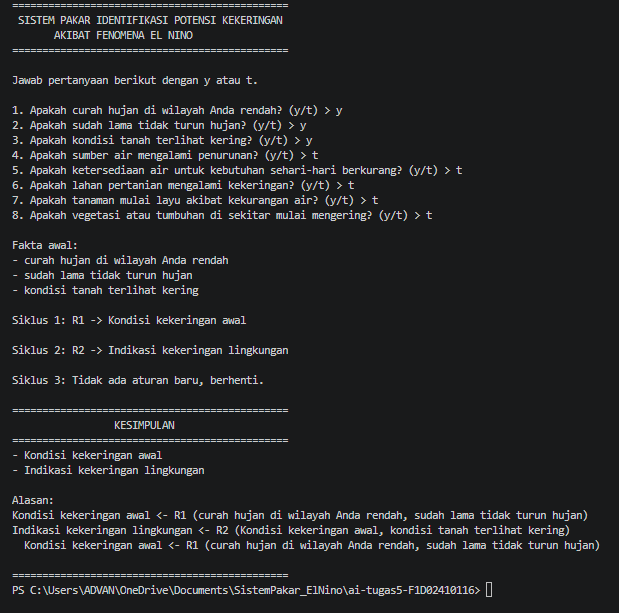
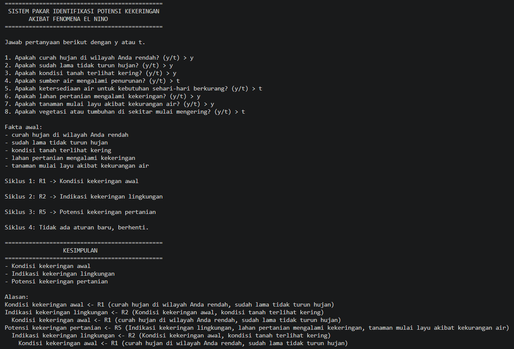
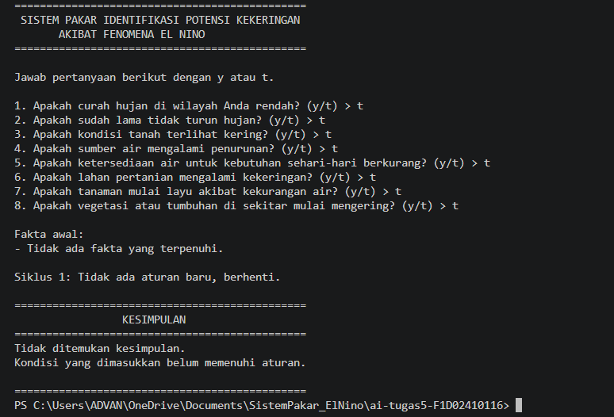

# Sistem Pakar Identifikasi Potensi Kekeringan akibat Fenomena El Niño

## 1. Identitas

- **Nama        :** Istiqomah Virginia
- **NIM         :** F1D02410116
- **Mata Kuliah :** Kecerdasan Buatan

## 2. Topik dan Deskripsi Program

Program ini merupakan sistem pakar sederhana untuk mengidentifikasi potensi kekeringan berdasarkan kondisi lingkungan yang dimasukkan oleh pengguna. Sistem menggunakan beberapa indikator, seperti rendahnya curah hujan, lamanya tidak turun hujan, kondisi tanah, ketersediaan sumber air, dan kondisi lahan pertanian. Program dibuat menggunakan bahasa pemrograman **Python** dengan metode **Forward Chaining**. Basis pengetahuan berupa fakta, aturan IF-THEN, dan kesimpulan disimpan dalam file `aturan.json`, kemudian dibaca dan diproses oleh `main.py`.

**Tujuan program** yaitu untuk memberikan gambaran awal mengenai indikasi kekeringan berdasarkan fakta yang dimasukkan pengguna.

## 3. Struktur File

```text
SistemPakar_ElNino/
│
├── main.py
├── aturan.json
├── README.md
│
└── screenshot/
    ├── kasus1.png
    ├── kasus2.png
    └── kasus3.png
```

## 4. Cara Menjalankan Program

### Persyaratan

- Python versi 3.10 atau lebih baru.
- Editor kode, seperti Visual Studio Code.
- Terminal atau Command Prompt.

### Langkah menjalankan

1. Clone atau download repository ini.
2. Buka folder proyek menggunakan Visual Studio Code.
3. Pastikan file `main.py` dan `aturan.json` berada dalam folder yang sama.
4. Buka terminal.
5. Jalankan perintah berikut:

```bash
python main.py
```

6. Jawab setiap pertanyaan dengan memasukkan:
   - `y` untuk Ya.
   - `t` untuk Tidak.

7. Program akan menampilkan fakta awal, proses Forward Chaining, kesimpulan, dan alasan aturan yang digunakan.

## 5. Sumber Referensi

Sumber referensi digunakan sebagai dasar penyusunan pengetahuan mengenai fenomena El Niño, kondisi curah hujan, dan indikator kekeringan.

| No. |                                                     Judul Sumber                               | Penerbit |
|-----|------------------------------------------------------------------------------------------------|-------|
|  1  | BMKG: El Niño Sangat Kuat sedang Terjadi, Musim Hujan 2026/2027 Diprediksi Datang Lebih Lambat | BMKG |
|  2  | Hari Tanpa Hujan (HTH)                                                                         | Stasiun Pemantau Atmosfer Global  BMKG Lore Lindu Bariri |
|  3  | Prakiraan Cuaca Indonesia Sepekan Periode 15–21 September 2026: Atmosfer Kering Mendominasi, Karhutla dan Asap Meluas | BMKG |

**Tautan sumber:**

1. https://www.bmkg.go.id/berita/utama/bmkg-el-nino-sangat-kuat-sedang-terjadi-musim-hujan-2026-2027-diprediksi-datang-lebih-lambat
2. https://gaw-bariri.bmkg.go.id/publikasi/gawsarium/240-hari-tanpa-hujan-hth
3. https://www.bmkg.go.id/cuaca/potensi-hujan-sepekan/prakiraan-cuaca-indonesia-sepekan-periode-15-21-september-2026-atmosfer-kering-mendominasi-karhutla-dan-asap-meluas-tetap-waspada-hujan-lokal-dan-angin-kencang-di-sebagian-wilayah-indonesia

**Tanggal akses:** 14 November 2026.

## 6. Basis Pengetahuan dan Tabel Aturan

Basis pengetahuan terdiri dari 8 fakta, 6 aturan, dan 6 kemungkinan kesimpulan.

### A. Daftar Fakta

|Kode|                    Fakta                               |
|----|--------------------------------------------------------|
| F1 | Curah hujan di wilayah rendah                          |
| F2 | Sudah lama tidak turun hujan                           |
| F3 | Kondisi tanah terlihat kering                          |
| F4 | Sumber air mengalami penurunan                         |
| F5 | Ketersediaan air untuk kebutuhan sehari-hari berkurang |
| F6 | Lahan pertanian mengalami kekeringan                   |
| F7 | Tanaman mulai layu akibat kekurangan air               |
| F8 | Vegetasi atau tumbuhan di sekitar mulai mengering      |

### B. Tabel Aturan IF-THEN

|Kode|   Kondisi (IF)   | Kesimpulan (THEN) |
|----|------------------|-------------------|
| R1 | F1 AND F2        | G1                |
| R2 | G1 AND F3        | G2                |
| R3 | G2 AND F4        | G3                |
| R4 | G3 AND F5        | G4                |
| R5 | G2 AND F6 AND F7 | G5                |
| R6 | G2 AND F8        | G6                |

### C. Daftar Kesimpulan

|Kode|                 Kesimpulan                   |
|----|----------------------------------------------|
| G1 | Kondisi kekeringan awal                      |
| G2 | Indikasi kekeringan lingkungan               |
| G3 | Potensi penurunan ketersediaan air           |
| G4 | Potensi kekurangan air bersih                |
| G5 | Potensi kekeringan pertanian                 |
| G6 | Potensi peningkatan risiko kebakaran lahan   |

## 7. Metode yang Digunakan

Metode yang digunakan adalah **Forward Chaining**, yaitu metode penalaran yang dimulai dari fakta-fakta awal yang diberikan pengguna untuk memperoleh kesimpulan berdasarkan aturan yang tersedia. Metode ini dipilih karena proses identifikasi dimulai dari jawaban pengguna, kemudian sistem mencocokkan fakta tersebut dengan aturan IF-THEN hingga tidak ditemukan aturan baru.

### Tahapan Forward Chaining

1. **Input fakta:** pengguna menjawab pertanyaan dengan Ya atau Tidak.
2. **Pencocokan aturan:** sistem memeriksa apakah fakta awal memenuhi kondisi pada aturan IF-THEN.
3. **Penarikan kesimpulan:** apabila kondisi aturan terpenuhi, sistem menghasilkan fakta atau kesimpulan baru.
4. **Pengulangan:** sistem kembali memeriksa aturan menggunakan fakta yang sudah diperoleh.
5. **Berhenti:** proses selesai ketika tidak ada aturan baru yang dapat dijalankan.
6. **Menampilkan hasil:** sistem menampilkan kesimpulan dan alasan aturan yang menghasilkan kesimpulan tersebut.

## 8. Pengujian Program

Program diuji menggunakan tiga kasus dengan kombinasi jawaban yang berbeda.

### Kasus 1: Menghasilkan Kesimpulan Indikasi Kekeringan Lingkungan

**Input:**

|Fakta| Jawaban |
|----|---|
| F1 | Ya |
| F2 | Ya |
| F3 | Ya |
| F4 | Tidak |
| F5 | Tidak |
| F6 | Tidak |
| F7 | Tidak |
| F8 | Tidak |

**Proses:**

- Siklus 1: R1 → G1 (Kondisi kekeringan awal).
- Siklus 2: R2 → G2 (Indikasi kekeringan lingkungan).
- Siklus 3: Tidak ada aturan baru, proses berhenti.

**Kesimpulan:** Indikasi kekeringan lingkungan.

**Screenshot:**



### Kasus 2: Menghasilkan Kesimpulan Potensi Kekeringan Pertanian

**Input:**

| Fakta | Jawaban |
|---|---|
| F1 | Ya |
| F2 | Ya |
| F3 | Ya |
| F4 | Tidak |
| F5 | Tidak |
| F6 | Ya |
| F7 | Ya |
| F8 | Tidak |

**Proses:**

- Siklus 1: R1 → G1 (Kondisi kekeringan awal).
- Siklus 2: R2 → G2 (Indikasi kekeringan lingkungan).
- Siklus 3: R5 → G5 (Potensi kekeringan pertanian).
- Siklus 4: Tidak ada aturan baru, proses berhenti.

**Kesimpulan:**
- Kondisi kekeringan awal.
- Indikasi kekeringan lingkungan.
- Potensi kekeringan pertanian.

**Screenshot:**



### Kasus 3: Tidak Menghasilkan Kesimpulan

**Input:**

| Fakta | Jawaban |
|---|---|
| F1 | Tidak |
| F2 | Tidak |
| F3 | Tidak |
| F4 | Tidak |
| F5 | Tidak |
| F6 | Tidak |
| F7 | Tidak |
| F8 | Tidak |

**Proses:**

- Siklus 1: Tidak ada aturan baru, proses berhenti.

**Kesimpulan:**

Tidak ditemukan kesimpulan karena fakta yang dimasukkan belum memenuhi kondisi pada aturan yang tersedia.

**Screenshot:**



## 9. Batas Keberlakuan Sistem

Pengetahuan dalam sistem ini disusun berdasarkan informasi dari BMKG mengenai fenomena El Niño, kondisi curah hujan, hari tanpa hujan, serta kondisi lingkungan yang berkaitan dengan kekeringan. Sistem digunakan untuk memberikan gambaran awal mengenai potensi kekeringan berdasarkan jawaban pengguna terhadap pertanyaan yang tersedia. Aturan yang digunakan merupakan penyederhanaan pengetahuan ke dalam bentuk IF-THEN dan tidak mencakup seluruh faktor penyebab kekeringan. Sistem ini bukan alat prediksi resmi BMKG, tidak dapat memastikan bahwa suatu wilayah sedang mengalami El Niño atau kekeringan, dan hasilnya hanya berupa saran awal, bukan keputusan akhir. Untuk mengetahui kondisi sebenarnya, pengguna tetap perlu mengacu pada informasi dan peringatan resmi BMKG serta instansi terkait.

## 10. Penggunaan Alat Bantu AI

Dalam pengerjaan proyek ini, ChatGPT digunakan sebagai alat bantu untuk mencari ide topik, menyusun rancangan aturan IF-THEN, membantu penulisan kode Python, serta menyusun dokumentasi README. Sumber referensi tetap dicantumkan dan digunakan sebagai dasar penyusunan pengetahuan sistem. Kode program dan hasil pengujian perlu diperiksa kembali oleh pengembang sebelum digunakan.